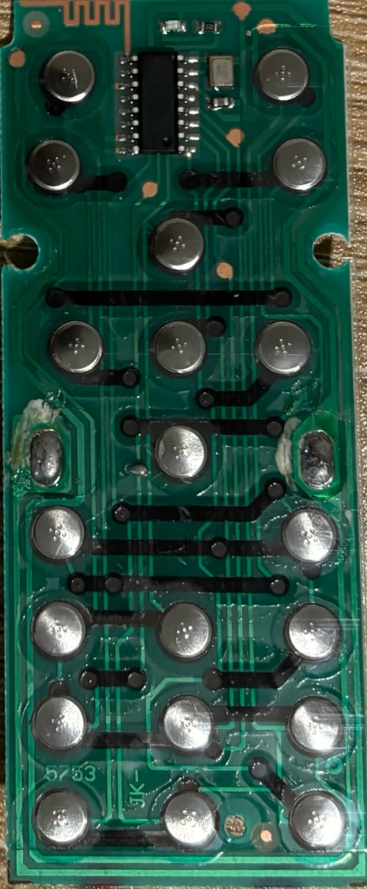
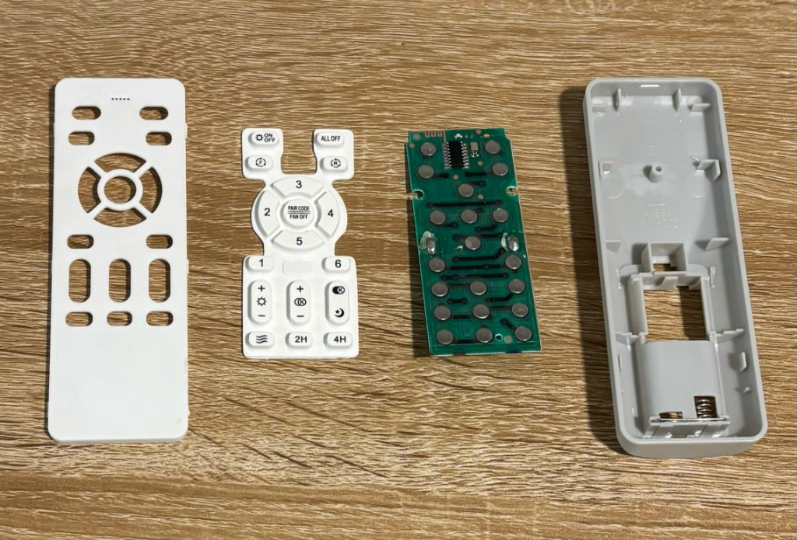
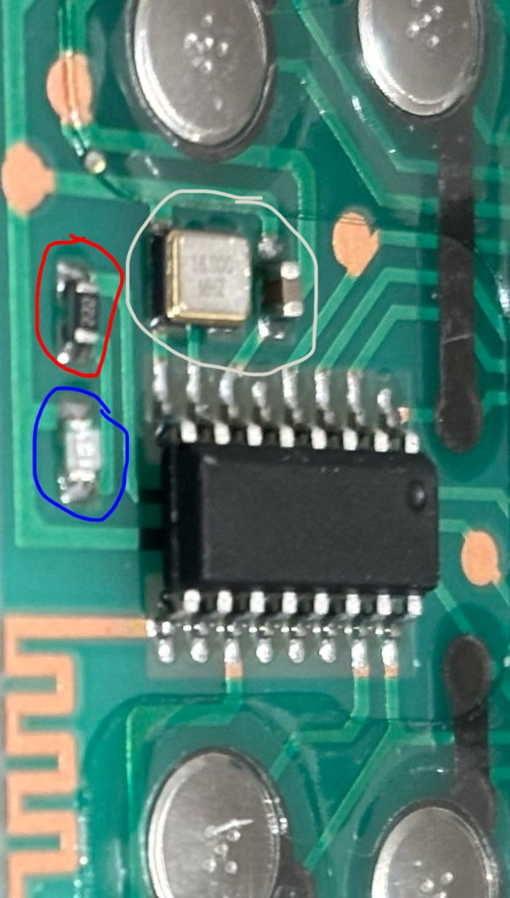
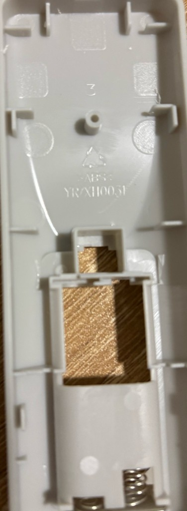
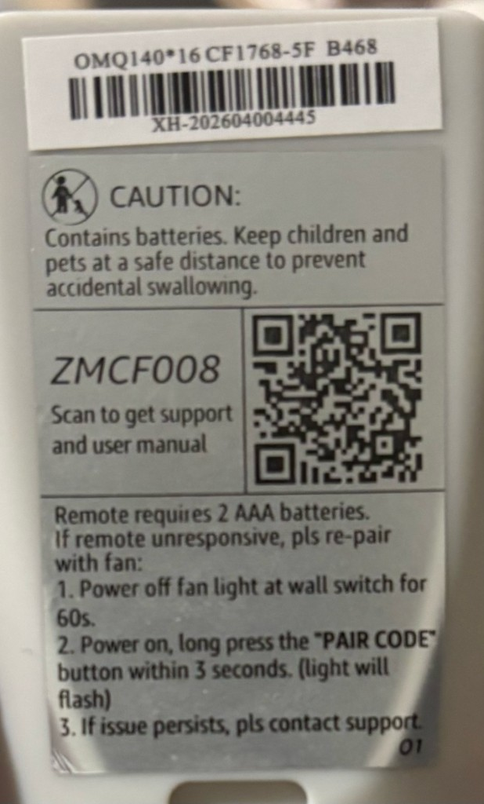
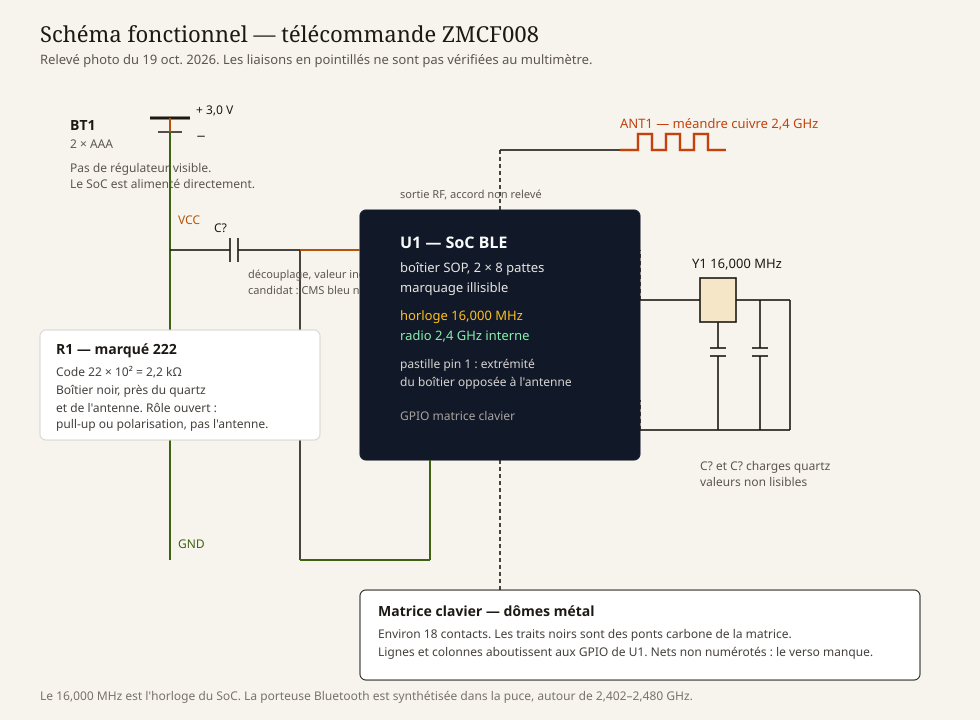
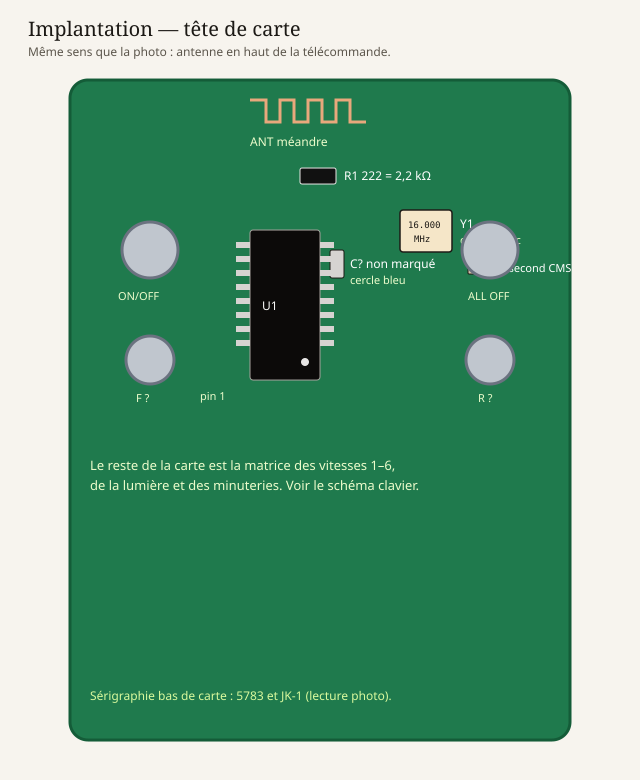
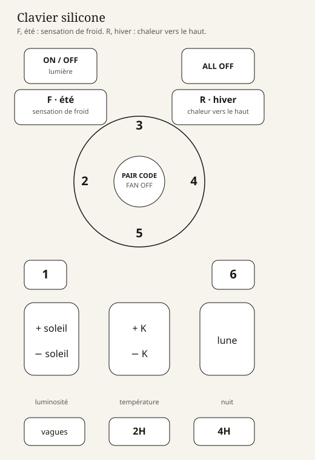

# Matériel — télécommande ZMCF008

Relevé visuel du 19 octobre 2026. Les fils en pointillés des schémas n’ont pas été passés au multimètre. Le verso de la carte n’a pas été photographié.

Retour au [sommaire](../README.md). Protocole : [protocole.md](protocole.md). Installation : [home-assistant.md](home-assistant.md).

## Produit

| | |
|---|---|
| Annonce | ZMISHIBO ventilateur de plafond 132 cm, LED 20 W dimmable, moteur DC réversible, blanc/bois, classe F |
| Modèle collé sur la télécommande | **ZMCF008** |
| Référence étiquette | `OMQ140*16 CF1768-5F B468` |
| Code-barres | `XH-202604004445` |
| Piles | 2 × AAA, 3,0 V |
| Boîtier | ABS, marque moule `YRXH0051`, chiffre `3` |
| Application | FanLamp Pro, éditeur Shenzhen Jingyuan Micro Control Technology |
| Identifiants app | Android `com.jingyuan.fan_lamp`, Apple [id1570374552](https://apps.apple.com/us/app/fanlamp-pro/id1570374552) |

La fiche Amazon du 132 cm indique parfois « infrarouge ». C’est faux pour cette télécommande : le cuivre en haut de carte est une antenne, il n’y a pas de LED infrarouge.

`XH-202604004445` est la lecture de la photo. Le `7` de `202704` est un `6`.

## Photos











Les pastilles piles et une partie des pistes sont sur le verso, non photographié.

## Les trois cercles de la macro

La macro est tournée d’un quart de tour par rapport à la carte entière. Antenne à gauche sur la macro, antenne en haut sur la carte.

| Cercle | Pièce | Lecture |
|---|---|---|
| Blanc | Quartz CMS, boîtier métallique | **16.000 MHz**, pas 16 000 MHz. C’est l’horloge du SoC. |
| Rouge | CMS noir, marquage `222` | Résistance **2,2 kΩ** (code `22 × 10²`). |
| Bleu | CMS clair, sans marquage | Condensateur céramique. Valeur inconnue. |

Un second petit CMS beige est visible à côté du quartz, sur la vue d’ensemble. Même famille : capacité, valeur illisible.

`222` n’est pas dans l’antenne. Une résistance de 2,2 kΩ en série avec une antenne 50 Ω étoufferait le 2,4 GHz. C’est plutôt un pull-up ou une polarisation. Le rôle exact se tranche au continuité-mètre : vers quelle patte du SoC, vers le plus, ou vers la masse.

## Schémas







### Chaîne d’alimentation et radio

```
2 x AAA (3 V)
    |
    +-- C? découplage -- masse
    |
    +-- U1  SoC BLE, SOP 16 broches, marquage absent
            +-- Y1  16,000 MHz + deux capacités de charge
            +-- R1  2,2 kΩ (222), réseau à identifier
            +-- ANT méandre cuivre, bande 2,4 GHz
            +-- GPIO -- matrice de dômes métal
```

Il n’y a **pas de module Bluetooth séparé**. La puce noire est à la fois le microcontrôleur, le clavier et l’émetteur. Les pastilles oranges sont des vias : la carte a au moins deux couches.

Le quartz à 16 MHz est l’horloge. La porteuse Bluetooth (canaux 2,402 à 2,480 GHz) est fabriquée dans la puce par une boucle à verrouillage de phase. On ne la lit pas sur le boîtier du quartz.

L’alimentation est le 3,0 V des deux piles AAA, sans régulateur visible.

### Repères carte

- Pastille du pin 1 : extrémité du boîtier **opposée à l’antenne** (bas de la puce quand l’antenne est en haut).
- Huit pattes de chaque côté, donc SOP-16. À recompter sur la pièce, la photo est juste assez nette pour ce compte.
- Sérigraphie en bas : `5783` et `JK-1`.
- Dépôt blanc sur le bord gauche : colle ou flux, pas un composant.
- Quatre trous en haut de la façade. Aucune LED n’est visible sur la face photographiée.

Des télécommandes FanLamp Pro du même genre (démonte [Fanbulous TL-FSW071-011](https://www.eevblog.com/forum/reviews/fanbulous-smart-outdoor-ceiling-fan-remote-control-teardown-tl-fsw071-011/)) utilisent aussi un SOP-16, parfois marqué `TL19KF61111`. Le dessus de celle-ci est noir et lisse sur la photo. Un éclairage rasant, ou un coton avec un peu d’alcool isopropylique, fait souvent ressortir une gravure laser.

## Clavier

Appui court du centre : arrêt du ventilateur. Appui long : appairage.

| Touche | Rôle retenu |
|---|---|
| ON/OFF | lumière |
| ALL OFF | lumière et ventilateur |
| F | été : sensation de froid |
| R | hiver : garde la chaleur en la renvoyant vers le haut |
| 1 à 6 | vitesses |
| PAIR CODE / FAN OFF | arrêt ventilateur, ou appairage si maintenu |
| soleil + / soleil − | luminosité |
| colonne K + / − | température de couleur |
| lune | veilleuse |
| vagues | vent naturel |
| 2H, 4H | minuteries |

Consigne imprimée au dos :

1. Couper le ventilateur à l’interrupteur mural pendant 60 s.
2. Rétablir le courant, puis maintenir **PAIR CODE** dans les 3 secondes. La lumière doit clignoter.
3. Sinon, contacter le support.

Les manuels de la même famille (FanLamp Pro) disent aussi : téléphone avec Bluetooth allumé, bouton Pair de l’application dans les 5 secondes après la mise sous tension. La lumière ou un bip confirme.

Cette procédure **délie** la télécommande déjà en service. Elle n’a pas été refaite : Home Assistant a copié l’identifiant existant. Voir [home-assistant.md](home-assistant.md).

## Mesures encore ouvertes

1. Photo du **verso**, lumière rasante.
2. Macro du dessus de U1, lumière rasante, pour une éventuelle gravure.
3. Comptage des pattes.
4. Continuité : plus pile, masse pile, deux pattes du quartz, R1 `222`, antenne.

## Sources

- Étiquette, photos de la carte et du silicone, ce dossier.
- [FanLamp Pro sur l’App Store](https://apps.apple.com/us/app/fanlamp-pro/id1570374552)
- Démonte [Fanbulous TL-FSW071-011](https://www.eevblog.com/forum/reviews/fanbulous-smart-outdoor-ceiling-fan-remote-control-teardown-tl-fsw071-011/)
- Manuels d’une carte jumelle pour l’appairage FanLamp Pro : notice Lowe’s du CFL-1174-01 et notice Home Depot citant la même procédure.
